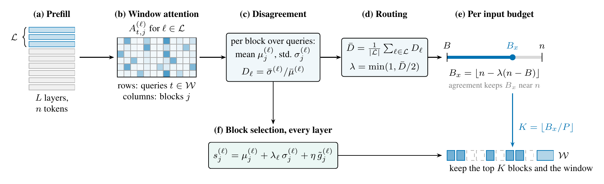
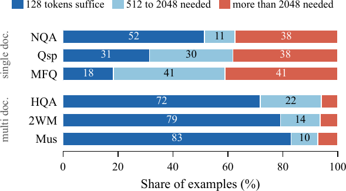
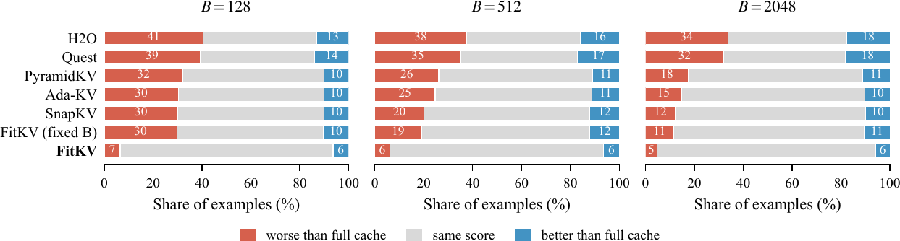

# FitKV: Fitting the KV Cache Budget to Each Input for Long Context Inference

Official code for the paper *"FitKV: Fitting the KV Cache Budget to Each Input for Long Context Inference"*.

📄 **Paper:** [paper.pdf](paper.pdf)



*Figure: (a) after the prompt pass, the queries and KV cache of every layer are available, and the last third of the layers forms the late layer set; (b) the window queries attend to the context blocks; (c) each block gets a mean and a standard deviation of attention over the queries, and their ratio measures how much the queries disagree; (d) the late layer average gives the routing scalar λ; (e) λ places the input's budget between the minimum B and the full length n; (f) every layer keeps its top blocks together with the window.*

## Abstract

The key value (KV) cache of a large language model (LLM) grows linearly with the input and dominates memory in long context inference. Eviction methods reduce it by keeping the tokens that receive the most attention, but they give every input the same budget, although some inputs can be answered from a small part of their context and others need nearly all of it. We propose FitKV, a training free method that measures how strongly the final prompt queries agree on where to attend, and uses this agreement to give each input a budget between a user given minimum and its full length. On LongBench, with every comparison made on identical examples, FitKV outperforms fixed budget methods at small budgets on all three LLMs we test, and with a minimum of 128 tokens it retains at least 96% of full cache accuracy in every task category, compared with 52 to 93% for fixed budgets. An ablation attributes the gain to the input adaptive budget rather than to token selection.

## Motivation



*Figure: smallest budget at which SnapKV reproduces the full cache score, per example, on six LongBench question answering tasks. Most multi document examples need only 128 tokens, while 38 to 41% of single document examples need more than 2,048. No single fixed budget suits both.*

## Overview

FitKV compresses the KV cache once, after the prompt has been processed:

1. In the late layers (the last third), the last `w` prompt queries attend to the context, pooled into blocks of `P` tokens
2. Each block gets a mean `μ` and a standard deviation `σ` of attention over the queries; a layer's disagreement is `D = mean(σ) / mean(μ)`
3. The routing scalar is `λ = min(1, mean(D) / 2)`, and the input's budget is `B_x = ⌊n − λ (n − B)⌋`
4. Every layer keeps its `⌊B_x / P⌋` highest scoring blocks, with score `μ + λ_ℓ σ + η g`, where `g` measures how far a block's values differ from the window's attention output

When the queries agree, the budget stays near the full length; when they disagree, it shrinks toward the minimum `B`.

## Installation

Python 3.12 or newer is required (tested with 3.12 and 3.13). The default `python3` on many systems is older (macOS ships 3.9), so create the environment with an explicit 3.12 interpreter:

```bash
python3.12 -m venv .venv
source .venv/bin/activate
python --version            # should print Python 3.12 or newer
pip install -r requirements.txt
```

If `python3.12` is not found, install it first, for example with `brew install python@3.12` (macOS), `sudo apt install python3.12 python3.12-venv` (Ubuntu) or from [python.org](https://www.python.org/downloads/).

`requirements.txt` pins every package in the tested environment, including indirect dependencies. The package itself only needs `torch` and `pyyaml`. `transformers` is used by the Hugging Face example, and `pytest` by the tests.

Running the tests (from the repository root):

```bash
python -m pytest tests/
```

## Quick Start

### Using FitKV directly

FitKV takes one `[H, n, d]` tensor per layer for the keys, values and post rotary queries (one row per key value head), taken after the prompt pass. The snippet below uses random tensors so it runs as is from the repository root; with a real model, pass its cache and queries instead (see the Hugging Face example below).

```python
import torch
from fitkv import compress_kv_cache

layers, heads, n, d = 12, 2, 2048, 64
keys = [torch.randn(heads, n, d) for _ in range(layers)]
values = [torch.randn(heads, n, d) for _ in range(layers)]
queries = [torch.randn(heads, n, d) for _ in range(layers)]

budget, lam, kept = compress_kv_cache(keys, values, queries, minimum=128)
# keys and values are replaced in place; budget is B_x and lam is the routing scalar
print(budget, round(lam, 3), keys[0].shape)
```

### Comparing with the baselines

```python
import torch
from fitkv.compare import apply_method

layers, heads, n, d = 12, 2, 2048, 64
keys = [torch.randn(heads, n, d) for _ in range(layers)]
values = [torch.randn(heads, n, d) for _ in range(layers)]
queries = [torch.randn(heads, n, d) for _ in range(layers)]

budget = apply_method("snapkv", keys, values, queries, minimum=128)
print(budget, keys[0].shape)
```

### Running on a Hugging Face model

```bash
python examples/compress_prompt.py --model Qwen/Qwen2.5-0.5B-Instruct --budget 128
```

The first run downloads the model from the Hugging Face Hub (about 1 GB for Qwen2.5-0.5B). The script runs the prompt once, captures the post rotary queries of every layer, averages the query heads within each key value group (as in the paper), and compresses the cache with FitKV. It prints the prompt length, the routing scalar λ and the chosen budget.

> **Scope:** this repository contains FitKV and the baselines. The benchmark harness used for the paper's runs (LongBench loading, job scheduling and result aggregation) is not included.

## Methods Compared

| Method | Paper | Key Idea | Name in `apply_method` |
|--------|-------|----------|------------------------|
| **FitKV** (ours) | This paper | Per input budget from late layer query disagreement | `fitkv` |
| FitKV, fixed budget | This paper (ablation) | FitKV block selection with λ = 1 | `fitkv_fixed` |
| SnapKV | [Li et al. 2024](https://arxiv.org/abs/2404.14469) | Attention of the final observation window | `snapkv` |
| H2O | [Zhang et al. 2023](https://arxiv.org/abs/2306.14048) | Attention accumulated over all prompt queries | `h2o` |
| Quest | [Tang et al. 2024](https://arxiv.org/abs/2406.10774) | Upper bound of query and key dot products per block | `quest` |
| PyramidKV | [Cai et al. 2024](https://arxiv.org/abs/2406.02069) | SnapKV scores with a budget that decreases across layers | `pyramidkv` |
| Ada-KV | [Feng et al. 2025](https://arxiv.org/abs/2407.11550) | Per head budgets through global competition across heads | `adakv` |
| Full cache | | Keeps every token | `full` |

All methods share the block size, observation window, always kept blocks and budget floor, so differences come only from the selection rule and the budget. Quest is applied once after the prompt rather than at every generation step, and Ada-KV is a block level adaptation of the original token level method.

## Main Results

LongBench (English), with every comparison made on identical examples. Scores are multiplied by 100; higher is better. Models: Qwen2.5-3B, Qwen2.5-7B and Llama-3.1-8B.

**Grid A:** mean over six question answering tasks (NarrativeQA, Qasper, MultiFieldQA, HotpotQA, 2WikiMultihopQA, MuSiQue), at budgets of 128, 512 and 2048 tokens per layer.

| Method | 3B, 128 | 3B, 512 | 3B, 2048 | 7B, 128 | 7B, 512 | 7B, 2048 |
|--------|--------:|--------:|---------:|--------:|--------:|---------:|
| *Full cache* | *26.4* | *26.4* | *26.4* | *18.6* | *18.6* | *18.6* |
| H2O | 10.6 | 13.8 | 15.9 | 10.6 | 12.2 | 14.3 |
| Quest | 11.6 | 14.5 | 16.6 | 12.3 | 14.4 | 15.9 |
| SnapKV | 18.8 | 23.6 | **26.2** | 14.3 | 17.3 | 18.1 |
| PyramidKV | 17.6 | 20.0 | 24.0 | 13.5 | 15.8 | 18.0 |
| Ada-KV | 19.1 | 22.3 | 26.0 | 13.9 | 15.5 | 18.4 |
| FitKV (fixed budget) | 18.8 | 24.2 | 25.9 | 14.4 | 17.3 | 18.5 |
| **FitKV** | **25.9** | **25.9** | 26.1 | **18.6** | **18.6** | **18.7** |

**Grid B:** budgets of 256 and 1024, on the tasks where all listed methods share identical examples (task count per column).

| Method | 3B, 256 (10) | 3B, 1024 (7) | 7B, 256 (5) | 7B, 1024 (7) | Llama, 256 (8) | Llama, 1024 (8) |
|--------|-----:|-----:|-----:|-----:|-----:|-----:|
| H2O | 16.0 | 25.1 | 24.3 | 23.7 | 20.2 | 22.4 |
| Quest | 17.9 | 26.5 | 30.1 | 27.8 | 20.1 | 22.0 |
| SnapKV | 22.6 | 36.1 | 42.1 | 38.4 | 24.5 | 27.4 |
| FitKV (fixed budget) | 23.1 | 36.4 | 42.0 | 38.5 | 24.7 | 27.6 |
| **FitKV** | **28.8** | **37.8** | **51.4** | **39.6** | **28.6** | **28.6** |

FitKV improves significantly on the best baseline in 10 of 12 settings (paired bootstrap, 95% intervals); the two exceptions are at B = 2048, where fixed budgets already approach the full cache. Its largest gains are at small budgets: +6.8 points on Qwen2.5-3B and +4.3 on Qwen2.5-7B at B = 128, and +9.2 on Qwen2.5-7B and +4.0 on Llama-3.1-8B at B = 256.


*Figure: share of full cache accuracy each method retains (Grid A). FitKV is the only method that retains at least 98% at every budget.*



*Figure: effect of eviction on individual examples relative to the full cache. At B = 128, fixed budget methods lower the score of 30 to 41% of examples; FitKV lowers 6.5%.*

## Configuration

Every hyperparameter is in [`fitkv/configs/fitkv.yaml`](fitkv/configs/fitkv.yaml), read through `fitkv/config.py`.

| Parameter | Default | Description |
|-----------|---------|-------------|
| `minimum` (B) | set per call | Minimum budget in tokens per layer (the only value you choose) |
| `block_size` (P) | 16 | Tokens per block |
| `window` (w) | 64 | Observation window, in prompt queries |
| `value_weight` (η) | 0.3 | Weight of the value term in the block score |
| `lambda_scale` | 2.0 | Divisor in λ = min(1, mean D / 2); fixed by hand, not tuned |
| `always_keep_blocks` | 2 | Final context blocks kept in every layer |
| `eps` | 1e-8 | Added to denominators to avoid division by zero |
| `smooth_width` | 5 | Moving average width along the token axis |

## File Structure

```
.
├── fitkv/
│   ├── core.py          # Budget formula, routing scalar, disagreement, block scores
│   ├── evict.py         # compress_kv_cache: FitKV on a per layer KV cache
│   ├── baselines.py     # SnapKV, H2O, Quest, PyramidKV, Ada-KV block scorers
│   ├── compare.py       # apply_method: one interface for every method
│   ├── config.py        # Loads the YAML configuration
│   └── configs/
│       └── fitkv.yaml   # All hyperparameters
├── examples/
│   └── compress_prompt.py   # FitKV on a Hugging Face model
├── tests/               # Budget, routing, selection and baseline tests
├── figures/             # Figures used in this README
├── paper.pdf            # The paper
├── requirements.txt     # Python dependencies
├── LICENSE              # MIT
└── README.md            # This file
```

## Citation

```bibtex
@inproceedings{fitkv2026,
  title={FitKV: Fitting the KV Cache Budget to Each Input for Long Context Inference},
  author={Paul Trust},
  year={2026}
}
```

## License

MIT. See [LICENSE](LICENSE).
