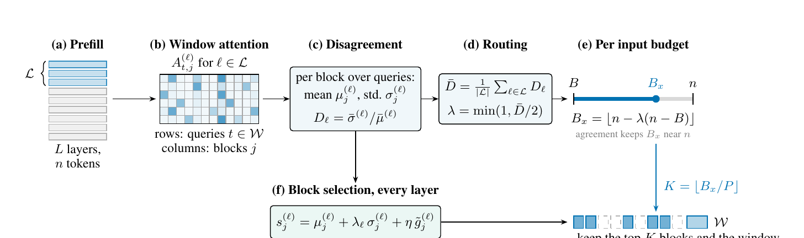
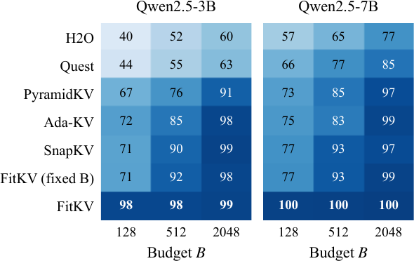

# FitKV: Fitting the KV Cache Budget to Each Input for Long Context Inference

Training free KV cache compression that gives each input its own budget.

📄 **Paper:** the paper is under review; a link will be added when it is available.



*Figure: FitKV overview. (a) After the prompt pass, every layer has its queries and KV cache. (b) In the late layers, the window queries attend to the context blocks. (c) Each block gets a mean and a standard deviation over the queries, and their ratio measures how much the queries disagree. (d) The late layer average gives the routing scalar λ. (e) λ places the budget $B_x$ between the minimum $B$ and the full length $n$. (f) Every layer keeps its top $\lfloor B_x/P \rfloor$ blocks together with the window.*

## Abstract

KV cache eviction methods keep the same number of tokens for every input, although some inputs can be answered from a small part of their context and others need nearly all of it. FitKV measures how strongly the final prompt queries disagree about where to attend, in the late layers of the model, and uses that disagreement to set an input's budget between a user given minimum and its full length. Blocks are then selected per layer with the same attention statistics and a value term. On LongBench, with identical examples for every method, FitKV stays within 0.6 points of the full cache at every budget on Qwen2.5-3B and Qwen2.5-7B, where the best fixed budget method falls 4.2 to 7.3 points below it at a 128 token minimum.

## Method

Let `W` be the last `w` prompt positions, the context be split into blocks of `P` tokens, and `L` be the late layers (the last third of the layers).

1. **Window attention.** Each window query attends to the context; the attention is smoothed along tokens and pooled into blocks, giving `A[t, j]`.
2. **Disagreement.** For each block, `mu[j]` and `sigma[j]` are the mean and standard deviation over the window. The layer disagreement is `D = mean(sigma) / mean(mu)`.
3. **Routing.** `lambda = min(1, mean over late layers of D / 2)`, and the budget of the input is `B_x = floor(n - lambda (n - B))`.
4. **Block selection.** Each layer scores its blocks with `s[j] = mu[j] + lambda_l sigma[j] + eta g[j]`, where `g` is a value term, and keeps the top `floor(B_x / P)` blocks together with the window.

## Installation

```bash
pip install -r requirements.txt
```

## Usage

```python
from fitkv import compress_kv_cache

# keys, values, queries: one [H, n, d] tensor per layer, after the prompt pass
budget, lam, kept = compress_kv_cache(keys, values, queries, minimum=128)
```

`keys` and `values` are replaced in place. `budget` is the input's budget `B_x` and
`lam` is the routing scalar.

To compare methods on one prompt with a Hugging Face model:

```bash
python examples/compress_prompt.py --model Qwen/Qwen2.5-0.5B-Instruct --budget 128
```

## Baselines

The repository includes the methods compared in the paper. They share the block size,
observation window, always kept blocks and budget floor, so the differences come from the
selection rule.

| Method | Name in `apply_method` | Selection rule | Paper |
|--------|------------------------|----------------|-------|
| Full cache | `full` | Keeps every token | |
| FitKV | `fitkv` | Adaptive budget and block selection (this method) | |
| FitKV, fixed budget | `fitkv_fixed` | FitKV block selection with `lambda = 1` | |
| SnapKV | `snapkv` | Attention of the final window, pooled over the window | [arXiv:2404.14469](https://arxiv.org/abs/2404.14469) |
| H2O | `h2o` | Attention accumulated over all prompt queries; sink blocks kept | [arXiv:2306.14048](https://arxiv.org/abs/2306.14048) |
| Quest | `quest` | Upper bound of query and key dot products per block | [arXiv:2406.10774](https://arxiv.org/abs/2406.10774) |
| PyramidKV | `pyramidkv` | SnapKV scores with a linear budget schedule across layers | [arXiv:2406.02069](https://arxiv.org/abs/2406.02069) |
| Ada-KV | `adakv` | Per head SnapKV scores with global competition and a per head floor | [arXiv:2407.11550](https://arxiv.org/abs/2407.11550) |

Official code for the baselines:

- SnapKV, via the [kvpress](https://github.com/NVIDIA/kvpress) library, which ports its scoring.
- [H2O](https://github.com/FMInference/H2O)
- [Quest](https://github.com/mit-han-lab/quest)
- [PyramidKV](https://github.com/Zefan-Cai/PyramidKV)
- [Ada-KV](https://github.com/FFY0/AdaKV)

```python
from fitkv.compare import apply_method
budget = apply_method("snapkv", keys, values, queries, minimum=128)
```

Notes:

- **Quest** is applied once after the prompt. The original design selects pages at every decoding step, so this measures Quest as a one shot eviction method.
- **PyramidKV** keeps a per layer budget that decreases with depth and averages to the minimum `B`, so its cache differs by layer while its mean matches the others.
- **Ada-KV** is a block level adaptation of AdaKV. The original works per token within each head.

## Configuration

Every hyperparameter is in [`configs/fitkv.yaml`](configs/fitkv.yaml). The code reads them
through `fitkv/config.py`, so there are no values hidden in the source. The main settings are:

| Section | Key | Default | Meaning |
|---------|-----|---------|---------|
| `fitkv` | `block_size` | 16 | Tokens per block, P |
| `fitkv` | `window` | 64 | Observation window in queries, w |
| `fitkv` | `value_weight` | 0.3 | Weight of the value term, eta |
| `fitkv` | `always_keep_blocks` | 2 | Final blocks kept in every layer |
| `fitkv` | `lambda_scale` | 2.0 | Divisor in lambda, set by hand |
| `numerics` | `eps` | 1e-8 | Added to denominators to avoid division by zero |
| `numerics` | `smooth_width` | 5 | Moving average width along the token axis |
| `baselines` | `h2o_sink_tokens` | 4 | Initial tokens H2O keeps |
| `baselines` | `pyramidkv_beta` | 20 | Smallest layer budget is the average divided by beta |
| `baselines` | `adakv_floor_alpha` | 0.20 | Per head share kept by Ada-KV |

To change a value, edit the YAML file. For example, `block_size: 32` makes every method use 32-token blocks.

## Results

Results from the paper, on LongBench (English tasks). Mean score over six question answering
tasks (NarrativeQA, Qasper, MultiFieldQA, HotpotQA, 2WikiMultihopQA, MuSiQue), with identical
examples for every method. Higher is better. These numbers come from the paper's benchmark
harness, which is not included in this repository.

| Method | Qwen2.5-3B, B=128 | Qwen2.5-3B, B=512 | Qwen2.5-3B, B=2048 | Qwen2.5-7B, B=128 | Qwen2.5-7B, B=512 | Qwen2.5-7B, B=2048 |
|--------|------:|------:|------:|------:|------:|------:|
| Full cache | 26.4 | 26.4 | 26.4 | 18.6 | 18.6 | 18.6 |
| H2O | 10.6 | 13.8 | 15.9 | 10.6 | 12.2 | 14.3 |
| Quest | 11.6 | 14.5 | 16.6 | 12.3 | 14.4 | 15.9 |
| SnapKV | 18.8 | 23.6 | 26.2 | 14.3 | 17.3 | 18.1 |
| PyramidKV | 17.6 | 20.0 | 24.0 | 13.5 | 15.8 | 18.0 |
| Ada-KV | 19.1 | 22.3 | 26.0 | 13.9 | 15.5 | 18.4 |
| FitKV (fixed budget) | 18.8 | 24.2 | 25.9 | 14.4 | 17.3 | 18.5 |
| **FitKV** | **25.9** | **25.9** | **26.1** | **18.6** | **18.6** | **18.7** |

FitKV improves on the best fixed budget method by 6.8 points on Qwen2.5-3B at `B=128`
and by 4.3 points on Qwen2.5-7B at `B=128`. Its advantage is largest at small budgets and
closes at `B=2048`. On Llama-3.1-8B and the other budgets, see the paper.



*Figure: Share of full cache accuracy each method retains, Grid A (six question answering tasks).*


*Figure: Effect of eviction on individual examples relative to the full cache. FitKV lowers the score of about 6% of examples at `B=128`; fixed budget methods lower 30 to 41%.*

Full tables, per task scores and paired bootstrap intervals are in the paper.

## Scope

This repository contains the method and the baselines. It does not include the benchmark
harness (dataset loading, batch scheduling and result aggregation) used for the paper's experiments.

## Tests

```bash
python -m pytest tests/
```

## Citation

```bibtex
@inproceedings{fitkv2026,
  title={FitKV: Fitting the KV Cache Budget to Each Input for Long Context Inference},
  author={Paul Trust},
  year={2026}
}
```

## License

MIT. See [LICENSE](LICENSE).
